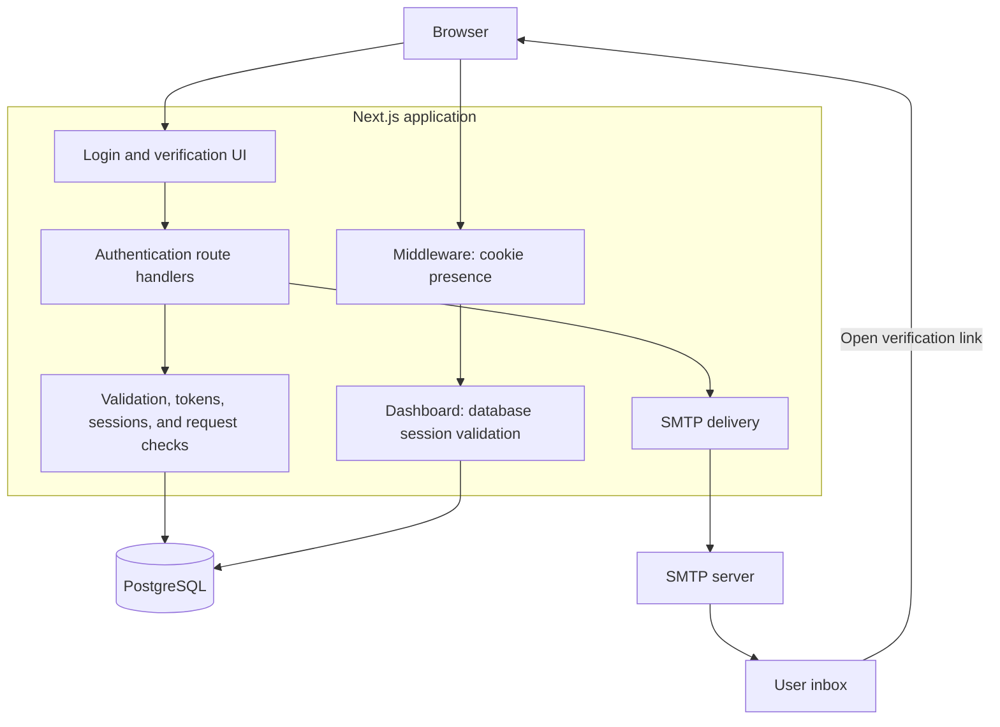
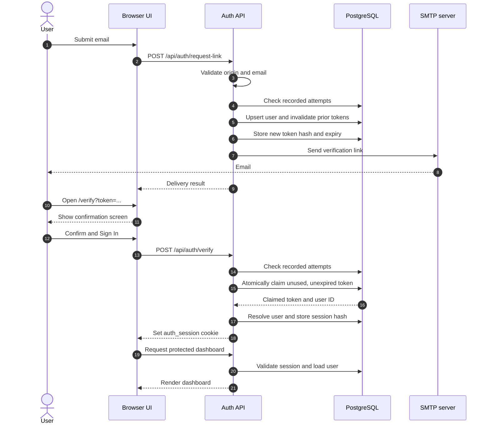

<div align="center">

# Architecture

> A concise technical guide to College IDP's email authentication flow, component boundaries, and persistence model.

[README](../README.md) · [API reference](API.md) · [Database reference](DATABASE.md) · [Security notes](SECURITY.md)

## System overview

College IDP is a single Next.js application containing the interface, HTTP API, and server-side authentication logic. PostgreSQL is the source of truth for identities and sessions. SMTP is the external delivery channel for magic links.

The application implements authentication through its own SQL queries and token lifecycle. Supabase can provide PostgreSQL hosting; the login flow does not use Supabase Auth. Email is the only supported sign-in channel.



## Component responsibilities

| Component           | Source                                                                                       | Responsibility                                                                                         |
| :------------------ | :------------------------------------------------------------------------------------------- | :----------------------------------------------------------------------------------------------------- |
| Authentication UI   | [`src/components/auth`](src/components/auth)                                                 | Collect email, request links, display delivery status, and require explicit verification confirmation. |
| Route handlers      | [`src/app/api/auth`](src/app/api/auth)                                                       | Coordinate validation, rate limits, token operations, delivery, and cookies.                           |
| Authentication core | [`src/lib/auth`](src/lib/auth)                                                               | Generate and hash secrets, validate input, resolve identities, and manage sessions.                    |
| Database layer      | [`src/lib/db`](src/lib/db)                                                                   | Manage connections, execute parameterized queries, and map SQL rows to application types.              |
| Email delivery      | [`src/lib/messaging`](src/lib/messaging)                                                     | Render email templates, validate SMTP settings, and report delivery results.                           |
| Dashboard boundary  | [`src/middleware.ts`](src/middleware.ts), [`dashboard/page.tsx`](src/app/dashboard/page.tsx) | Check cookie presence first, then validate the session before rendering protected data.                |
| Demo support        | [`src/lib/demo`](src/lib/demo)                                                               | Hold a bounded in-memory event buffer and expose local previews outside production.                    |

## Authentication lifecycle



### 1. Request and delivery

`POST /api/auth/request-link` validates the request and accepts only `type: "email"`. Email input is trimmed and lowercased. After rate-limit checks, the server upserts the user, attempts to invalidate previous active tokens, and generates a new token using `crypto.randomBytes(32)`.

The database receives the SHA-256 token hash and a 10-minute expiry. The raw token appears in a verification URL built from `NEXT_PUBLIC_APP_URL`, which is passed to SMTP delivery. The production response does not include the raw link; development demo mode can expose it locally.

### 2. Confirmation and token consumption

Opening `/verify` displays a confirmation view. Token consumption happens only after the client submits `POST /api/auth/verify`, reducing accidental redemption by systems that merely fetch or render email links.

The token claim uses a conditional update:

```sql
UPDATE auth_tokens
SET used_at = NOW()
WHERE token_hash = $1
  AND used_at IS NULL
  AND expires_at > NOW()
RETURNING id, user_id, expires_at, used_at, created_at;
```

PostgreSQL coordinates concurrent updates to the same token row. Only a request that receives a claimed row proceeds. An unsuccessful claim is classified as invalid, expired, or already used.

### 3. Session and authorization

Successful verification generates a separate 32-byte session secret. The server stores its SHA-256 hash with a seven-day expiry and sends the raw secret in the `auth_session` cookie.

| Cookie setting | Value                       |
| :------------- | :-------------------------- |
| `HttpOnly`     | `true`                      |
| `SameSite`     | `lax`                       |
| `Secure`       | `true` in production        |
| `Path`         | `/`                         |
| Lifetime       | Based on the session expiry |

The cookie contains an opaque secret, not an encrypted identity payload. Middleware only checks whether it exists. Protected server rendering and the session endpoint hash the secret and query PostgreSQL for an unexpired, unrevoked session joined to its user. Logout marks the session as revoked and clears the cookie.

## Persistence model

| Table                     | Stores                                                         | Lifecycle                                                    |
| :------------------------ | :------------------------------------------------------------- | :----------------------------------------------------------- |
| `users`                   | Identity and timestamps                                        | Upserted by normalized email when a link is requested.       |
| `auth_tokens`             | User reference, `token_hash`, expiry, and `used_at`            | Created for each link; marked used on claim or invalidation. |
| `sessions`                | User reference, `session_token_hash`, expiry, and `revoked_at` | Created after verification; revoked on logout.               |
| `authentication_attempts` | Identifier, hashed IP, success flag, and timestamp             | Used by sliding-window rate-limit queries.                   |

A user can have multiple token and session records. Nullable phone columns remain for existing data compatibility, but the request API cannot create an SMS login flow.

The runtime database client prefers `DATABASE_URL` and falls back to `DIRECT_URL`; migrations reverse that priority. The client is lazily initialized, allows up to 10 connections per process, and disables prepared statements for transaction-pooler compatibility. The schema source is [`sql/schema.sql`](sql/schema.sql).

## Request controls and failure behavior

| Control                  | Current behavior                                                                                      |
| :----------------------- | :---------------------------------------------------------------------------------------------------- |
| Origin validation        | Compares Origin host with Host when both headers exist; requests missing either header are permitted. |
| Link origin              | Constructed from `NEXT_PUBLIC_APP_URL`, rather than the incoming request host.                        |
| Link-request threshold   | 5 recorded attempts per email and 15 per IP within 15 minutes.                                        |
| Verification threshold   | 30 recorded attempts per IP within 15 minutes.                                                        |
| Rate-limit query failure | Returns `503`; processing does not continue.                                                          |
| SMTP failure             | Returns an error, including when development previews are enabled.                                    |
| Token failure            | Returns a classified invalid, expired, or already-used result.                                        |
| Production demo access   | Disabled; the demo-events endpoint returns `404`.                                                     |

Both endpoints count entries in the shared attempts table rather than independent per-endpoint counters. Rate checks and attempt writes are separate operations. Some attempt writes are best-effort, so these thresholds are not strict concurrent admission limits.

## Implementation boundaries

- **Atomicity is scoped to token consumption.** Token creation, SMTP delivery, token consumption, and session creation do not form one transaction. A session-write failure after a claim can leave a consumed token without a session, requiring a fresh link.
- **Previous-link invalidation is best-effort.** Its error is currently ignored, and invalidation and token insertion are separate operations. Concurrent requests can produce more than one active link.
- **Email acceptance is not inbox confirmation.** A successful SMTP response does not establish that the recipient received or opened the message.
- **Explicit confirmation reduces scanner-triggered claims.** It does not guarantee protection against automation that clicks controls or submits requests.
- **Demo data is local and ephemeral.** The buffer is process memory and can include raw links. It is neither shared storage nor an audit log.
- **Cleanup is not scheduled.** An expired-token deletion helper exists, but retention jobs must be configured separately.

## Verification and maintenance

Automated tests exercise cryptographic helpers, validation, session rules, email handling, demo isolation, and simulated authentication flows. They do not replace live database concurrency tests or a real SMTP and browser sign-in check.

When changing the lifecycle, review the route handler, its authentication helper, the relevant SQL query, and the client state together. Keep this document, [the API reference](API.md), and [the database reference](DATABASE.md) aligned with the implementation.

</div>
