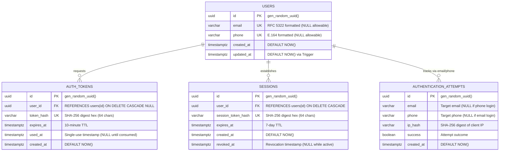

# Database Architecture & Schema Specification (Supabase PostgreSQL)

## 1. Architectural Scope & Constraints

- **Pure PostgreSQL Database:** Supabase is utilized solely as a managed PostgreSQL relational database.
- **Zero Supabase Auth SDK:** The project does **NOT** use `@supabase/supabase-js`, GoTrue, Supabase Auth tables (`auth.users`), Supabase Storage, or Edge Functions.
- **Server-Side Access:** Database connections are strictly established from Node.js server runtimes via connection pooling (`DATABASE_URL` via PgBouncer port 6543) and direct connection (`DIRECT_URL` port 5432).
- **Zero Plaintext Tokens:** No plaintext magic link tokens or session cookies are ever written to the database. All token values stored are 64-character hexadecimal SHA-256 digests.

---

## 2. Entity-Relationship Diagram



---

## 3. Table Schemas, Constraints & Indexes

### 1. `users` Table

Stores verified identities. A user can register/authenticate via email, phone, or both.

| Column       | Type           | Constraints                             | Description                                       |
| :----------- | :------------- | :-------------------------------------- | :------------------------------------------------ |
| `id`         | `UUID`         | `PRIMARY KEY DEFAULT gen_random_uuid()` | Universally unique user identifier                |
| `email`      | `VARCHAR(255)` | `UNIQUE NULL`                           | Normalized lowercase email address                |
| `phone`      | `VARCHAR(32)`  | `UNIQUE NULL`                           | E.164 normalized international phone number       |
| `created_at` | `TIMESTAMPTZ`  | `NOT NULL DEFAULT NOW()`                | Identity registration timestamp                   |
| `updated_at` | `TIMESTAMPTZ`  | `NOT NULL DEFAULT NOW()`                | Timestamp of last user modification (via trigger) |

**Constraints & Triggers:**

- `chk_user_identifier`: `CHECK ((email IS NOT NULL AND email <> '') OR (phone IS NOT NULL AND phone <> ''))` — Guarantees at least one valid communication channel exists.
- `trg_users_updated_at`: `BEFORE UPDATE` trigger automatically updating `updated_at = NOW()`.

**Indexes:**

- `idx_users_email`: `CREATE INDEX ON users(email) WHERE email IS NOT NULL;`
- `idx_users_phone`: `CREATE INDEX ON users(phone) WHERE phone IS NOT NULL;`

---

### 2. `auth_tokens` Table

Stores one-way cryptographic SHA-256 digests of temporary magic link tokens.

| Column       | Type          | Constraints                                   | Description                                              |
| :----------- | :------------ | :-------------------------------------------- | :------------------------------------------------------- |
| `id`         | `UUID`        | `PRIMARY KEY DEFAULT gen_random_uuid()`       | Unique token identifier                                  |
| `user_id`    | `UUID`        | `REFERENCES users(id) ON DELETE CASCADE NULL` | Linked user ID (if account exists prior to verification) |
| `token_hash` | `VARCHAR(64)` | `NOT NULL UNIQUE`                             | SHA-256 hex digest of the 32-byte secret random token    |
| `expires_at` | `TIMESTAMPTZ` | `NOT NULL`                                    | Token expiration timestamp (Default: 10 minutes)         |
| `used_at`    | `TIMESTAMPTZ` | `NULL`                                        | Timestamp when claimed. Once set, cannot be reused.      |
| `created_at` | `TIMESTAMPTZ` | `NOT NULL DEFAULT NOW()`                      | Generation timestamp                                     |

**Indexes:**

- `idx_auth_tokens_hash`: B-tree index on `token_hash` for instantaneous $O(1)$ token lookups.
- `idx_auth_tokens_user_id`: Foreign key index for cascade lookups.
- `idx_auth_tokens_active`: Partial index on `(expires_at, used_at) WHERE used_at IS NULL` for blazing-fast validation of unconsumed tokens.

---

### 3. `sessions` Table

Stores authenticated sessions associated with the HTTP-only `auth_session` cookie.

| Column               | Type          | Constraints                                       | Description                                     |
| :------------------- | :------------ | :------------------------------------------------ | :---------------------------------------------- |
| `id`                 | `UUID`        | `PRIMARY KEY DEFAULT gen_random_uuid()`           | Unique session identifier                       |
| `user_id`            | `UUID`        | `NOT NULL REFERENCES users(id) ON DELETE CASCADE` | Associated user identity                        |
| `session_token_hash` | `VARCHAR(64)` | `NOT NULL UNIQUE`                                 | SHA-256 hex digest of the session cookie secret |
| `expires_at`         | `TIMESTAMPTZ` | `NOT NULL`                                        | Session expiration timestamp (Default: 7 days)  |
| `created_at`         | `TIMESTAMPTZ` | `NOT NULL DEFAULT NOW()`                          | Session establishment timestamp                 |
| `revoked_at`         | `TIMESTAMPTZ` | `NULL`                                            | Immediate server-side revocation timestamp      |

**Indexes:**

- `idx_sessions_token_hash`: B-tree index on `session_token_hash` for fast cookie validation.
- `idx_sessions_user_id`: B-tree index on `user_id` to query or revoke all sessions for a user.
- `idx_sessions_valid`: Partial index on `(expires_at, revoked_at) WHERE revoked_at IS NULL`.

---

### 4. `authentication_attempts` Table

Records authentication activity for sliding-window rate limiting, intrusion detection, and auditing.

| Column       | Type           | Constraints                             | Description                         |
| :----------- | :------------- | :-------------------------------------- | :---------------------------------- |
| `id`         | `UUID`         | `PRIMARY KEY DEFAULT gen_random_uuid()` | Unique attempt identifier           |
| `email`      | `VARCHAR(255)` | `NULL`                                  | Target email address                |
| `phone`      | `VARCHAR(32)`  | `NULL`                                  | Target phone number                 |
| `ip_hash`    | `VARCHAR(64)`  | `NOT NULL`                              | SHA-256 digest of client IP address |
| `success`    | `BOOLEAN`      | `NOT NULL DEFAULT false`                | Status of attempt                   |
| `created_at` | `TIMESTAMPTZ`  | `NOT NULL DEFAULT NOW()`                | Attempt timestamp                   |

**Constraints:**

- `chk_attempt_target`: `CHECK ((email IS NOT NULL AND email <> '') OR (phone IS NOT NULL AND phone <> ''))`

**Indexes:**

- `idx_attempts_ip_hash`: Compound index on `(ip_hash, created_at DESC)` for IP-based sliding window queries.
- `idx_attempts_email`: Partial index on `(email, created_at DESC) WHERE email IS NOT NULL` for email rate checks.
- `idx_attempts_phone`: Partial index on `(phone, created_at DESC) WHERE phone IS NOT NULL` for phone rate checks.

---

## 4. Key Atomic Operations & SQL Queries

### A. Atomic Single-Use Token Consumption

```sql
UPDATE auth_tokens
SET used_at = NOW()
WHERE token_hash = $1
  AND used_at IS NULL
  AND expires_at > NOW()
RETURNING id, user_id, token_hash, expires_at, used_at, created_at;
```

_Concurrency Guarantee:_ If multiple concurrent requests present the same token, PostgreSQL's row-level lock ensures only the first transaction modifies `used_at` and returns the row. All competing requests return zero rows, thwarting token replay attacks.

### B. Session Verification with User Join

```sql
SELECT
  s.id, s.user_id, s.session_token_hash, s.expires_at, s.created_at, s.revoked_at,
  u.email, u.phone, u.created_at AS user_created_at, u.updated_at AS user_updated_at
FROM sessions s
INNER JOIN users u ON s.user_id = u.id
WHERE s.session_token_hash = $1
  AND s.revoked_at IS NULL
  AND s.expires_at > NOW()
LIMIT 1;
```

### C. Sliding-Window Rate Limit Verification

```sql
SELECT COUNT(*)::text AS count
FROM authentication_attempts
WHERE ip_hash = $1
  AND created_at >= NOW() - INTERVAL '15 minutes';
```

---

## 5. Migration & Connection Commands

```bash
# Test connection to PostgreSQL / Supabase
npm run db:test

# Apply database migrations to Supabase PostgreSQL
npm run db:migrate
```
