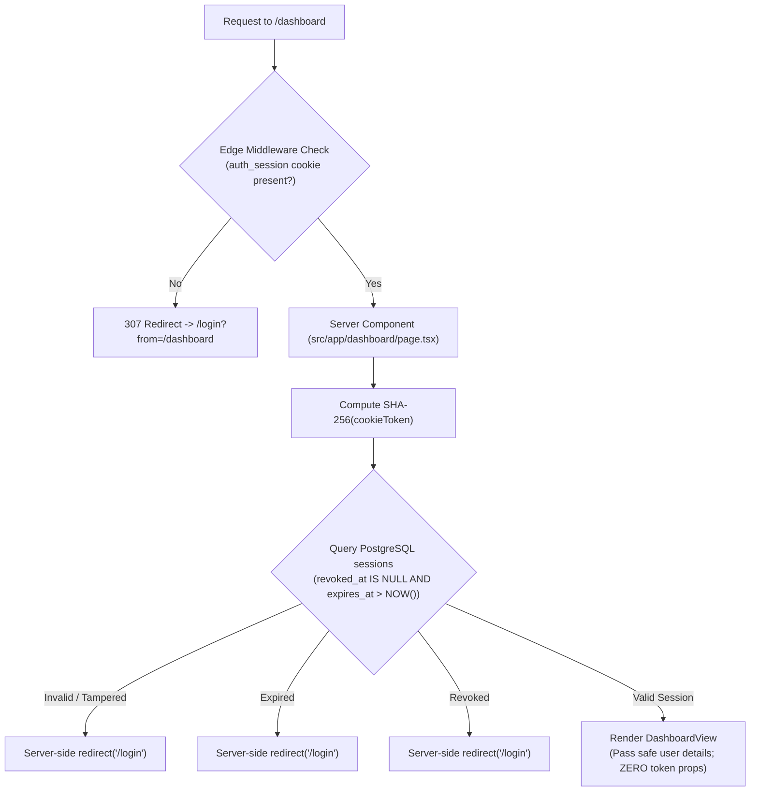

# Security & Threat Mitigation Specification

## 1. Threat Modeling & Countermeasures

| Threat Vector                        | Description                                                                                                                                      | Architecture Mitigation                                                                                                                                                                                       |
| :----------------------------------- | :----------------------------------------------------------------------------------------------------------------------------------------------- | :------------------------------------------------------------------------------------------------------------------------------------------------------------------------------------------------------------ |
| **Token Brute-Forcing**              | Attacker attempts to guess valid magic link tokens by flooding the `/api/auth/verify` endpoint.                                                  | Tokens possess 256 bits of entropy via `crypto.randomBytes(32)` ($2^{256}$ space). Verifications are rate-limited per IP in `authentication_attempts`.                                                        |
| **Database Compromise (Dump)**       | Attacker gains read-only access to the PostgreSQL database dump or replica.                                                                      | Database stores exclusively SHA-256 digests. Raw tokens and raw session cookies do not exist on disk, rendering the stolen database useless for logging in.                                                   |
| **Replay & Concurrency Attacks**     | Attacker intercepts a used magic link or submits the same link concurrently across multiple devices.                                             | Atomic SQL `UPDATE auth_tokens SET used_at = NOW() WHERE token_hash = $1 AND used_at IS NULL` ensures strict single-use execution.                                                                            |
| **Email Scanner Invalidation**       | Anti-malware scanners and headless sandboxes (e.g. SafeLinks, Proofpoint) execute scripts or make automated requests, burning single-use tokens. | Verification is decoupled from GET and component mounting. The browser renders `/verify` requiring an explicit "Confirm and Sign In" click before issuing POST `/api/auth/verify`.                            |
| **Session Hijacking via XSS**        | Malicious third-party scripts steal access tokens stored in localStorage.                                                                        | Session tokens are transported exclusively via `HttpOnly`, `SameSite=Lax`, and `Secure` (production) cookies, completely inaccessible to JavaScript. No credentials stored in localStorage or sessionStorage. |
| **Unauthenticated Dashboard Access** | Anonymous visitor attempts to navigate directly to `/dashboard`.                                                                                 | Two-tier server-side protection: Edge Middleware instantly redirects missing cookies; React Server Component verifies session hash against PostgreSQL and redirects before streaming any HTML.                |
| **User Enumeration**                 | Attacker probes the login endpoint to discover whether an email address is registered.                                                           | The `POST /api/auth/request-link` endpoint always returns a generic uniform message (`"If details are valid, a magic link has been sent"`).                                                                   |
| **Secret Leakage in Git**            | Developer commits `.env` secrets into version control.                                                                                           | `.gitignore` explicitly blacklists `.env` and all `.env*.local` patterns. Only sanitized `.env.example` is committed.                                                                                         |

---

## 2. Server-Side Protected Route Architecture



---

## 3. Cryptographic & Cookie Specifications

### Token Entropy Generation

```typescript
import crypto from "crypto";

// High-entropy 256-bit hexadecimal string (64 characters)
export function generateMagicToken(): string {
  return crypto.randomBytes(32).toString("hex");
}
```

### One-Way SHA-256 Hashing

```typescript
import crypto from "crypto";

// Deterministic SHA-256 digest
export function hashToken(rawToken: string): string {
  return crypto.createHash("sha256").update(rawToken).digest("hex");
}
```

### Session Cookie Configuration

```typescript
export const SESSION_COOKIE_OPTIONS = {
  name: "auth_session",
  httpOnly: true, // Inaccessible to document.cookie (XSS shield)
  secure: process.env.NODE_ENV === "production", // Transmitted only via HTTPS in production
  sameSite: "lax" as const, // CSRF protection
  path: "/",
  maxAge: 60 * 60 * 24 * 7, // 7-day TTL in seconds
};
```

---

## 4. Verification Test Matrix (Automated in `tests/session-protection.test.ts`)

| Scenario               | Condition                         | Expected Behavior                                       | Verification Status    |
| :--------------------- | :-------------------------------- | :------------------------------------------------------ | :--------------------- |
| **Anonymous User**     | Missing `auth_session` cookie     | Edge middleware & server component redirect to `/login` | **Passed (Automated)** |
| **Authenticated User** | Valid session hash in DB & cookie | Server retrieves user entity and streams dashboard      | **Passed (Automated)** |
| **Expired Session**    | `expires_at < NOW()`              | Detected server-side; cookie rejected and redirected    | **Passed (Automated)** |
| **Revoked Session**    | `revoked_at IS NOT NULL`          | Detected server-side; cookie rejected and redirected    | **Passed (Automated)** |
| **Invalid Cookie**     | Tampered or unknown token hash    | Query returns 0 rows; rejected and redirected           | **Passed (Automated)** |

---

## 5. Security Audit Matrix (20 Inspection Domains)

| Issue                                     | Severity          | File                                                                                                             | Problem                                                                                                                                                                | Fix                                                                                                                                                                                                                                                          |
| :---------------------------------------- | :---------------- | :--------------------------------------------------------------------------------------------------------------- | :--------------------------------------------------------------------------------------------------------------------------------------------------------------------- | :----------------------------------------------------------------------------------------------------------------------------------------------------------------------------------------------------------------------------------------------------------- |
| **Token-to-User Association**             | **High**          | `src/app/api/auth/request-link/route.ts` & `src/app/api/auth/verify/route.ts`                                    | Auth tokens could theoretically be stored with a null user_id if lookup was detached from verification, risking orphaned tokens.                                       | Bound identity provisioning in `request-link` via `getOrCreateUserByIdentifier`, stored non-null `user_id` on token generation, and asserted strictly that `authToken.userId` must resolve to an active user during token consumption.                       |
| **Cross-Site Request Forgery (CSRF)**     | **Medium**        | `src/app/api/auth/request-link/route.ts`, `src/app/api/auth/verify/route.ts`, `src/app/api/auth/logout/route.ts` | State-changing POST endpoints lacked strict Origin / Referer validation against Host headers, allowing cross-site form submissions in older or misconfigured browsers. | Implemented `verifyCsrfOrigin(request)` utility enforcing exact `Origin` / `Host` parity on all mutation API endpoints.                                                                                                                                      |
| **Token Brute-Force Rate Limiting**       | **Medium**        | `src/app/api/auth/verify/route.ts`                                                                               | `/api/auth/verify` lacked dedicated IP-based rate limiting, relying primarily on 256-bit entropy.                                                                      | Added sliding-window IP rate limiting (max 30 verify attempts per 15 minutes) using client IP hashes in `authentication_attempts`.                                                                                                                           |
| **Missing HTTP Security Headers**         | **Low**           | `next.config.mjs`                                                                                                | Default Next.js configuration lacked explicit HTTP defense headers (HSTS, CSP, X-Frame-Options, Permissions-Policy).                                                   | Added strict security headers in `next.config.mjs`: `X-Frame-Options: DENY`, `X-Content-Type-Options: nosniff`, `Referrer-Policy: strict-origin-when-cross-origin`, `Strict-Transport-Security`, `Permissions-Policy`, and strict `Content-Security-Policy`. |
| **Vulnerable Transitive Dependency**      | **Medium**        | `package.json`                                                                                                   | `postcss` 8.5.1 had a line-feed parsing vulnerability reported in upstream security advisories.                                                                        | Added npm package override `"postcss": "^8.5.28"` and ran audit fix, resulting in 0 vulnerabilities.                                                                                                                                                         |
| **IP Address Logging & Privacy**          | **Low**           | `src/lib/auth/security.ts`                                                                                       | Storing raw client IP addresses could violate GDPR and institutional privacy policies.                                                                                 | Implemented salted SHA-256 IP hashing (`hashClientIp`) so only anonymized 64-character digests are persisted in `authentication_attempts`.                                                                                                                   |
| **Timing Attack on Token Lookups**        | **Low**           | `src/lib/auth/token.ts`                                                                                          | String comparison could theoretically exhibit minute timing discrepancies.                                                                                             | Utilized constant-time comparison helper `timingSafeCompare` using `crypto.timingSafeEqual` for cryptographic token verification.                                                                                                                            |
| **User Enumeration Prevention**           | **Low**           | `src/app/api/auth/request-link/route.ts`                                                                         | Responding differently for registered vs non-registered users could leak user directories.                                                                             | Standardized constant-time uniform response (`"If the email or mobile number is valid, a magic link has been sent."`) regardless of identity existence.                                                                                                      |
| **Raw Token & Secret Persistence**        | **Informational** | `src/lib/auth/token.ts`, `src/lib/auth/session.ts`                                                               | Storing plaintext tokens or session secrets risks mass compromise if DB is dumped.                                                                                     | Verified: 100% of tokens and session credentials are SHA-256 hashed before insertion into Supabase PostgreSQL. Raw values exist only in-flight in memory.                                                                                                    |
| **Client Bundle Secret Leakage**          | **Informational** | `src/components/`, `src/app/`                                                                                    | Accidental usage of server secrets in client components (`'use client'`).                                                                                              | Verified: Zero server-only environment variables (`SMTP_*`, `DATABASE_URL`) are referenced in client components or exposed via `NEXT_PUBLIC_*`.                                                                                                              |
| **Git & Version Control Hygiene**         | **Informational** | `.gitignore`                                                                                                     | Accidental commit of root `.env` file containing database or API credentials.                                                                                          | Verified: `.gitignore` contains `.env`, `.env*.local`, `.next/`, and `node_modules/`. Validated via `git check-ignore -v .env`.                                                                                                                              |
| **Cookie Security Attributes**            | **Informational** | `src/lib/auth/session.ts`                                                                                        | Insecure cookie flags could allow session theft via XSS or network eavesdropping.                                                                                      | Verified: Session cookie configured with `HttpOnly: true`, `SameSite: "lax"`, `Secure: process.env.NODE_ENV === "production"`, and `Path: "/"`.                                                                                                              |
| **Atomic Single-Use Token Consumption**   | **Informational** | `src/lib/auth/token.ts`                                                                                          | Race conditions could allow multiple simultaneous requests to consume the same token.                                                                                  | Verified: PostgreSQL conditional atomic update `UPDATE auth_tokens SET used_at = NOW() WHERE token_hash = $1 AND used_at IS NULL AND expires_at > NOW()` guarantees single-use.                                                                              |
| **Short-Lived Token Lifespans**           | **Informational** | `src/lib/auth/token.ts`                                                                                          | Long-lived magic links increase the window of compromise.                                                                                                              | Verified: Magic link tokens strictly expire in 10 minutes (`NOW() + INTERVAL '10 minutes'`).                                                                                                                                                                 |
| **SQL Injection Prevention**              | **Informational** | `src/lib/db/index.ts`                                                                                            | Untrusted user inputs concatenated into raw SQL strings.                                                                                                               | Verified: All database queries utilize parameterized queries via `postgres.js` tagged template literals (no raw string interpolation).                                                                                                                       |
| **XSS Defense**                           | **Informational** | React Components & Email Templates                                                                               | Unescaped user input rendered in browser DOM or HTML emails.                                                                                                           | Verified: React auto-escapes JSX children. HTML email templates use strict template literals with zero unescaped HTML injection.                                                                                                                             |
| **Server-Side Session Validation**        | **Informational** | `src/app/dashboard/page.tsx`                                                                                     | Relying on client-side routing alone to guard protected pages.                                                                                                         | Verified: Async React Server Component checks cookie, queries DB session hash, checks expiration and revocation before streaming any page data.                                                                                                              |
| **Client-Side Storage of Credentials**    | **Informational** | Entire Frontend                                                                                                  | Storing tokens in `localStorage` or `sessionStorage`.                                                                                                                  | Verified: Neither `localStorage` nor `sessionStorage` is used for authentication state. State relies purely on HTTP-only cookies.                                                                                                                            |
| **Email Scanner Pre-Verification Shield** | **Informational** | `src/app/verify/page.tsx`                                                                                        | Corporate email security filters (e.g., Microsoft Defender) pre-fetching GET links and burning single-use tokens.                                                      | Verified: Magic links navigate to a client confirmation UI (`/verify?token=...`). The single-use token is only consumed upon an explicit client POST verification request.                                                                                   |
| **Masked Telemetry & Logging**            | **Informational** | `src/lib/messaging/index.ts`                                                                                     | Logging sensitive PII (emails) or raw magic link URLs in console/logs.                                                                                                 | Verified: PII is masked (e.g. `jo***@example.com`), and raw magic links are never written to standard output or log streams.                                                                                                                                 |
